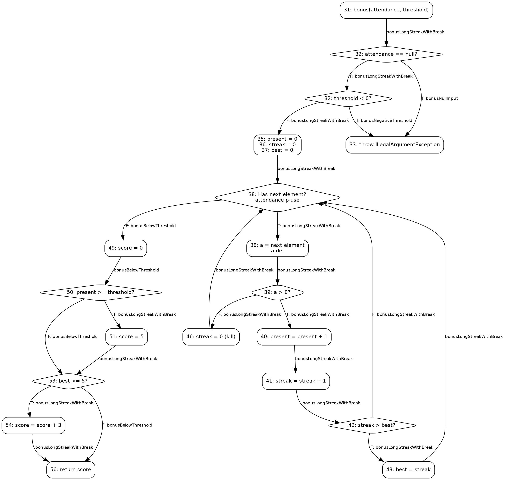

# Lab 10 — Data Flow Testing (DU Pairs)

**Оюутан:** Б.Дүүрэнбилэг  
**Код:** b232270032  
**Хичээл:** F.CSA313 — Программ хангамжийн чанарын баталгаа ба тест

## Environment

### java -version

```text
openjdk version "17.0.21.0.3" 2026-10-24
OpenJDK Runtime Environment (build 17.0.21.0.3+1-1-24.04.1-Ubuntu)
OpenJDK 64-Bit Server VM (build 17.0.21.0.3+1-1-24.04.1-Ubuntu, mixed mode, sharing)
```

### mvn -version

```text
Apache Maven 3.8.7
Maven home: /usr/share/maven
Java version: 17.0.21.0.3, vendor: Ubuntu, runtime: /usr/lib/jvm/java-17-openjdk-amd64
Default locale: en, platform encoding: UTF-8
OS name: "linux", version: "5.15.167.4-microsoft-standard-wsl2", arch: "amd64", family: "unix"
```

## A. gcd() — DU Analysis

Definition (def) нь хувьсагчид утга оноох үйлдэл.
c-use нь хувьсагчийн утгыг тооцоололд ашиглах,
p-use нь нөхцөл шалгахад ашиглах үйлдэл юм.

Def-clear зам гэдэг нь definition-ээс use хүртэл
тухайн хувьсагч дахин тодорхойлогдоогүй зам юм.

### A1. DU хосууд

| Хувьсагч | Def | Use | Төрөл | Def-clear зам | Тест | Хамрагдсан |
|---|---|---|---|---|---|---|
| x | 13 | 16 | c-use | 13→15(T)→16 | gcdWithTwoIterations | Тийм |
| x | 13 | 20 | c-use | 13→15(F)→20 | gcdWithoutLoop | Тийм |
| x | 17 | 16 | c-use | 17→18→15(T)→16 | gcdWithTwoIterations | Тийм |
| x | 17 | 20 | c-use | 17→18→15(F)→20 | gcdWithTwoIterations | Тийм |
| y | 13 | 15(T) | p-use | 13→15(T) | gcdWithTwoIterations | Тийм |
| y | 13 | 15(F) | p-use | 13→15(F) | gcdWithoutLoop | Тийм |
| y | 13 | 16 | c-use | 13→15(T)→16 | gcdWithTwoIterations | Тийм |
| y | 13 | 17 | c-use | 13→15(T)→16→17 | gcdWithTwoIterations | Тийм |
| y | 18 | 15(T) | p-use | 18→15(T) | gcdWithTwoIterations | Тийм |
| y | 18 | 15(F) | p-use | 18→15(F) | gcdWithTwoIterations | Тийм |
| y | 18 | 16 | c-use | 18→15(T)→16 | gcdWithTwoIterations | Тийм |
| y | 18 | 17 | c-use | 18→15(T)→16→17 | gcdWithTwoIterations | Тийм |
| tmp | 16 | 18 | c-use | 16→17→18 | gcdWithTwoIterations | Тийм |

Нийт: 13 DU хос, бүгд хамрагдсан.

### A2. Тестийн тайлбар

**gcdWithoutLoop**

- Оролт: gcd(7, 0)
- Хүлээгдсэн үр дүн: 7
- Давталт: 0
- Зөвхөн энэ тестээр хамрах хосууд:
  x(13→20), y(13→15F).

**gcdWithTwoIterations**

- Оролт: gcd(12, 8)
- Хүлээгдсэн үр дүн: 4
- Давталт: 2
- Эхний давталт: x=8, y=4.
- Хоёр дахь давталт: x=4, y=0.
- x(17→16), y(18→15T), y(18→16),
  y(18→17) зэрэг хосуудад дараагийн
  давталт шаардлагатай.

### A3. Дүгнэлт

gcd() функцэд x, y, tmp хувьсагчдын definition
болон use цэгүүдийг тодорхойлсон.
Нийт 13 DU хосыг олж, 2 JUnit тестээр
бүгдийг хамруулсан.

Давталтгүй болон олон давталттай замуудыг
хамруулснаар дахин тодорхойлогдсон
хувьсагчдын хэрэглээг шалгасан.


## B. bonus() — Data Flow Analysis

### B1. Control Flow Graph



CFG нь bonus() функцийн нөхцөл шалгалт,
давталт, утга оноолт болон return замуудыг
харуулна. Зангилаануудад эх кодын мөрийн
дугаарыг ашигласан.

### B2. Definition / Use жагсаалт

| Мөр | Definition (def) | Use | Төрөл |
|---|---|---|---|
| 31 | attendance, threshold | - | Параметр |
| 32 | - | attendance, threshold | p-use |
| 35 | present | - | def |
| 36 | streak | - | def |
| 37 | best | - | def |
| 38 | a (элемент бүрд) | attendance | def, p-use |
| 39 | - | a | p-use |
| 40 | present | present | def, c-use |
| 41 | streak | streak | def, c-use |
| 42 | - | streak, best | p-use |
| 43 | best | streak | def, c-use |
| 46 | streak | - | def (kill) |
| 49 | score | - | def |
| 50 | - | present, threshold | p-use |
| 51 | score | - | def |
| 53 | - | best | p-use |
| 54 | score | score | def, c-use |
| 56 | - | score | c-use |

**Тайлбар:**

- def: хувьсагчид утга оноох.
- c-use: тооцоолол эсвэл return-д ашиглах.
- p-use: нөхцөл шалгалтад ашиглах.
- kill: өмнөх definition-ийг шинэ утгаар солих.
- 38-р мөр: давталтын нөхцөл attendance-ийг
  шалгаж, элемент бүрийг a-д онооно.
- 46-р мөр: streak = 0 нь streak-ийн
  өмнөх definition-ийг kill хийнэ.
- 32-р мөр: threshold нь attendance null
  биш үед л шалгагдана (short-circuit OR).


### B3. DU хосуудын бүрэн хүснэгт

Хүснэгтэд зөвхөн def-clear замтай, биелэх боломжтой
DU хосуудыг оруулав. T = True, F = False.
Тестийн ID болон бодит хамралтыг B4 шатанд бөглөнө.

| Хувьсагч | Def | Use | Төрөл | Def-clear зам | Тестийн ID | Хамралт |
|---|---|---|---|---|---|---|
| attendance | 31 | 32T | p-use | 31→32T (null) | duNullAttendance | Тийм |
| attendance | 31 | 32F | p-use | 31→32F (non-null) | allDefsThresholdMet | Тийм |
| attendance | 31 | 38T | p-use | 31→32F→35→36→37→38T | allDefsThresholdMet | Тийм |
| attendance | 31 | 38F | p-use | 31→32F→35→36→37→38F | duEmptyBelowThreshold | Тийм |
| threshold | 31 | 32T | p-use | 31→32T (negative) | duNegativeThreshold | Тийм |
| threshold | 31 | 32F | p-use | 31→32F (nonnegative) | allDefsThresholdMet | Тийм |
| threshold | 31 | 50T | p-use | 31→32F→38...→49→50T | allDefsThresholdMet | Тийм |
| threshold | 31 | 50F | p-use | 31→32F→38...→49→50F | allDefsThresholdMissed | Тийм |
| a | 38 | 39T | p-use | 38→39T | allDefsThresholdMet | Тийм |
| a | 38 | 39F | p-use | 38→39F | allDefsThresholdMet | Тийм |
| present | 35 | 40 | c-use | 35→38T→39T→40 | allDefsThresholdMet | Тийм |
| present | 35 | 50T | p-use | 35→38F→49→50T | duEmptyThresholdZero | Тийм |
| present | 35 | 50F | p-use | 35→38F→49→50F | duEmptyBelowThreshold | Тийм |
| present | 40 | 40 | c-use | 40→38T→39T→40 | allDefsThresholdMet | Тийм |
| present | 40 | 50T | p-use | 40→38F→49→50T | allDefsThresholdMet | Тийм |
| present | 40 | 50F | p-use | 40→38F→49→50F | allDefsThresholdMissed | Тийм |
| streak | 36 | 41 | c-use | 36→38T→39T→40→41 | allDefsThresholdMet | Тийм |
| streak | 41 | 41 | c-use | 41→42→38T→39T→40→41 | allDefsThresholdMet | Тийм |
| streak | 41 | 42T | p-use | 41→42T | allDefsThresholdMet | Тийм |
| streak | 41 | 42F | p-use | 41→42F | allDefsThresholdMet | Тийм |
| streak | 41 | 43 | c-use | 41→42T→43 | allDefsThresholdMet | Тийм |
| streak | 46 | 41 | c-use | 46→38T→39T→40→41 | allDefsThresholdMet | Тийм |
| best | 37 | 42T | p-use | 37→38T→39T→40→41→42T | allDefsThresholdMet | Тийм |
| best | 37 | 53F | p-use | 37→38F→49→50→53F | duEmptyBelowThreshold | Тийм |
| best | 43 | 42T | p-use | 43→38T→39T→40→41→42T | allDefsThresholdMet | Тийм |
| best | 43 | 42F | p-use | 43→38T→39F→46→38T→39T→40→41→42F | allDefsThresholdMet | Тийм |
| best | 43 | 53T | p-use | 43→38F→49→50→53T | allDefsThresholdMet | Тийм |
| best | 43 | 53F | p-use | 43→38F→49→50→53F | duShortStreakBelowFive | Тийм |
| score | 49 | 54 | c-use | 49→50F→53T→54 | allDefsThresholdMissed | Тийм |
| score | 49 | 56 | c-use | 49→50F→53F→56 | duEmptyBelowThreshold | Тийм |
| score | 51 | 54 | c-use | 51→53T→54 | allDefsThresholdMet | Тийм |
| score | 51 | 56 | c-use | 51→53F→56 | duShortStreakBelowFive | Тийм |
| score | 54 | 56 | c-use | 54→56 | allDefsThresholdMet | Тийм |

**Нийт: 33 биелэх боломжтой DU хос.**

Давталтын 38-р мөрийн T нь дараагийн элемент
байгаа, F нь давталт дууссаныг илэрхийлнэ.
Зам дахь ... нь хувьсагчийг дахин тодорхойлохгүй
давталтын хэсгийг товчилсон тэмдэглэгээ юм.

### B3.1. Kill ба биелэх боломжгүй хосууд

**Kill:**

- 40-р мөр present-ийн өмнөх definition-ийг устгана.
- 41-р мөр streak-ийн өмнөх definition-ийг устгана.
- 43-р мөр best-ийн өмнөх definition-ийг устгана.
- 46-р мөр streak = 0 тул 36 эсвэл 41-р
  мөрөөс ирсэн streak-ийн definition-ийг устгана.
- 51-р мөр score-ийн 49-р мөрийн definition-ийг устгана.
- 54-р мөр score-ийн өмнөх definition-ийг устгана.

**Биелэх боломжгүй болон def-clear биш хосууд:**

1. streak(36→42T/F), streak(36→43):
   42, 43-р мөрд хүрэхээс өмнө 41-р мөр
   streak-д шинэ утга онооно.
2. streak(46→42T/F), streak(46→43):
   46-р мөрөөс дараагийн ирсэн өдөрт
   41-р мөр streak-ийг дахин тодорхойлно.
3. best(37→42F): best анх 0 бөгөөд
   эхний ирсэн өдрийн streak нь 1 тул
   42-р мөрийн нөхцөл заавал True байна.
4. best(37→53T): best >= 5 болохын тулд
   43-р мөрд шинэ best оноогдсон байх ёстой.
5. present(35→40)-ийн өмнө 40-р мөр
   ажилласан бол анхны def аль хэдийн kill болсон.
6. score(49→54) нь 50T салаагаар боломжгүй:
   51-р мөр score-д шинэ утга онооно.
7. score(49→56) нь 50T салаагаар боломжгүй:
   51-р мөр анхны definition-ийг kill хийнэ.

32-р мөрийн OR нөхцөл short-circuit үйлдэлтэй.
attendance == null бол threshold < 0 хэсэг
гүйцэтгэгдэхгүй. Ийм замд threshold-ийн
32-р мөрийн p-use хамрагдахгүй.


### B4. ALL-DEFS тест

ALL-DEFS хамралтыг 2 BonusTest тестээр шалгав.

1. allDefsThresholdMet — score-ийн 51 ба 54-р
   мөрийн definition-үүдийг use-д хүргэнэ.
   Мөн streak-ийн 46-р мөрийн reset-ийг шалгана.
2. allDefsThresholdMissed — score-ийн 49 ба
   54-р мөрийн definition-үүдийг use-д хүргэнэ.

Хамгийн багадаа 2 тест шаардлагатай. Учир нь
51-р мөр score-ийн 49-р мөрийн definition-ийг
kill хийдэг тул нэг гүйцэтгэлд эдгээр хоёр
definition-ийг хоёуланг нь use-д хүргэх боломжгүй.

ALL-DEFS нь бүх branch болон бүх DU хос
хамрагдсан гэсэн үг биш.

Бодит Maven болон JaCoCo үр дүнг
results/mvn-verify-alldefs.txt,
results/jacoco-alldefs.csv файлуудад хадгалсан.


### B5. JaCoCo хамралтын харьцуулалт

- ALL-DEFS үе: Branch: 13/16; Line: 22/24
- Эцсийн үе: Branch: 16/16; Line: 23/24
- Эцсийн JUnit: 10 тест, 0 алдаа.
- LINE_MISSED = 1 нь далд constructor-т хамаарна.

ALL-DEFS хамралт хангагдсан ч бүх branch
хамрагдсан гэсэн үг биш. Манай эхний шатанд
зарим branch хамрагдаагүй байсан.

Branch coverage 100% болсон ч DU хос бүр
хамрагдсан гэсэн баталгаа болохгүй.
Жишээлбэл, best-ийн 43→53F хосыг шалгахын
тулд duShortStreakBelowFive тест нэмсэн.
JaCoCo нь DU хосыг шууд хэмждэггүй.

## C. Fault Seeding

### C1. Мутацийн үр дүн

| Мутаци | Өөрчлөлт | Үр дүн |
|---|---|---|
| M1 | streak нэмэгдүүлэх үйлдлийг устгасан | KILLED: 9 тестээс 2 унасан |
| M2 | best = streak орны best = present | Эхэндээ SURVIVED, дараа нь KILLED |
| M3 | int total = present + best нэмсэн | SURVIVED: 10 тест бүгд давсан |

### C2. M1 — Missing Update

Унасан тестүүд:

- allDefsThresholdMet: expected 8, but was 5.
- allDefsThresholdMissed: expected 3, but was 0.

streak хувьсагч нэмэгдэхээ больсноор
дараалсан ирцийн нэмэлт оноо алдагдсан.

### C3. M2 — Wrong Variable

Эхний 9 тест мутацийг илрүүлээгүй.
Учир нь тэдгээр тестэд best шинэчлэгдэх
үед present болон streak-ийн утга ижил
байсан тул буруу оноолт гаралтыг өөрчлөөгүй.

duDetectWrongBestUpdate тестийг нэмж,
ирцийн цувааг дундаас нь тасалсан.

Оролт: [1,1,0,1,1,1,0,1,1,1,1]
Threshold: 5
Expected: 5
Actual (M2): 8

Ингэснээр M2 мутацийг илрүүлсэн.

### C4. M3 — Dead Definition

M3 мутацид дараах мөрийг нэмсэн:

`int total = present + best;`

total хувьсагчид утга оноосон боловч
дараа нь ашиглаагүй. Энэ нь програмын
гаралтад нөлөөлөөгүй тул 10 JUnit тест
бүгд амжилттай ажилласан.

Ийм төрлийн алдааг IDE-ийн inspection
эсвэл статик анализын хэрэгслээр илрүүлэх
боломжтой. Энгийн JUnit тест нь ашиглаагүй
локал хувьсагчийг заавал илрүүлэхгүй.

### C5. Эх кодыг сэргээсэн байдал

M1, M2, M3 мутацийг нэг нэгээр нь
туршиж, бүрийн дараа git restore хийсэн.
Эцсийн src/main код Starter хувилбартай
ижил хэвээр үлдсэн.

## Дүгнэлт

Энэ лабораторийн ажлаар өгөгдлийн урсгалын
Definition-Use анализыг хоёр функц дээр хийсэн.
gcd() функцийн DU хосуудыг тодорхойлж JUnit
тестээр шалгасан. bonus() функцэд CFG байгуулж,
хувьсагчдын definition болон use цэгүүдийг
тодорхойлсон. ALL-DEFS болон ALL-DU-PAIRS
хамралтыг тусдаа үе шатуудаар хэрэгжүүлсэн.
JaCoCo branch coverage 100% болсон боловч
энэ нь DU хос бүр хамрагдсаны баталгаа биш
гэдгийг ажигласан. Мутацийн туршилтаар
хоёр алдааг тестээр илрүүлсэн бол ашиглагдаагүй
хувьсагчийг тестүүд илрүүлээгүй. Хамгийн
их анхаарал шаардсан хэсэг нь def-clear
замуудыг тодорхойлох, мутацийг илрүүлэх
оролтыг сонгох ажил байв.

## AI Assistance

Лабораторийн ажлын явцад DU хосуудын анализ,
JUnit тест болон тайлан боловсруулахад AI
туслахаас зөвлөгөө авч, үр дүнг нягтлуулахад
ашигласан.

Кодын ажиллагааг Maven болон JUnit тестээр
шалгаж баталгаажуулсан.

### M3 Static Analysis

M3 мутацийн үед `int total = present + best;`
мөрийг түр нэмсэн.

Энэ хувьсагчийн утгыг цааш ашиглаагүй учраас
dead definition буюу ашиглагдаагүй definition
үүссэн.

JUnit-ийн 10 тест бүгд амжилттай болсон.
Java compiler мөн алдаа мэдээлээгүй.

Ашиглагдаагүй хувьсагчийг илрүүлэхэд
IDE inspection болон static analysis тохиромжтой.
M3-ийн туршилтын дараа эх кодыг сэргээсэн.

### M3 — PMD Static Analysis Result

M3 мутацийн үед ашиглагдаагүй локал хувьсагчийг
PMD 7.14.0 статик анализын хэрэгслээр шалгасан.

- Rule: UnusedLocalVariable
- File: DataFlowTargets.java
- Method: bonus()
- Line: 49
- Variable: total

PMD warning:

```text
Avoid unused local variables such as 'total'.
```

JUnit-ийн 10 тест M3 мутацийг илрүүлээгүй боловч
PMD статик анализ илрүүлсэн.

Нотолгоо: results/pmd-M3.xml

Мутацийн дараа DataFlowTargets.java файлыг
анхны хувилбарт сэргээсэн.
